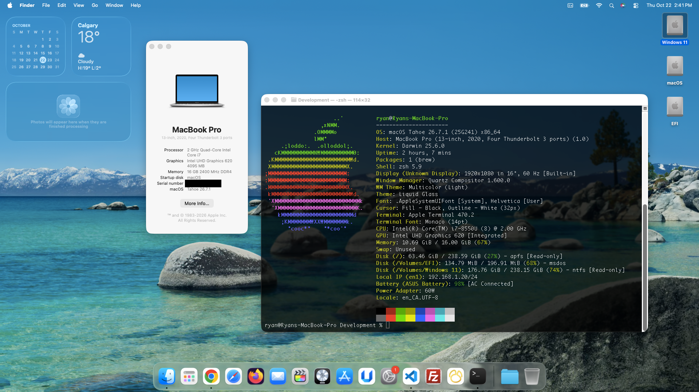

# Asus-S510UA-DS71-Hackintosh (macOS 26)
**Hackintosh Installation Guide for Asus VivoBook S10UA-DS71 and macOS 26.7.1 "Tahoe"** _(originally installed as 14.4.1 "Sonoma", then upgraded to 15.8 "Sequoia")_

Please consider [donating](https://paypal.me/djouija) to support this project. Thanks!

## Branches

Each macOS version has its own branch.  Switch branches with the branch menu at the top of the GitHub page _(or `git checkout <branch>`)_.

| **Branch** | **macOS** | **Bootloader** | **EFI folder** |
|------------|-----------|----------------|----------------|
| [`tahoe`](https://github.com/ouija/Asus-S510UA-DS71-Hackintosh/tree/tahoe)  ← _you are here_ | **26.7.1 Tahoe** _(default, latest)_ | OpenCore 1.0.8 | [macOS_26/EFI/OC](https://github.com/ouija/Asus-S510UA-DS71-Hackintosh/tree/tahoe/macOS_26/EFI/OC) |
| [`sequoia`](https://github.com/ouija/Asus-S510UA-DS71-Hackintosh/tree/sequoia) | 15.8 Sequoia | OpenCore 1.0.7 | [macOS_15/EFI/OC](https://github.com/ouija/Asus-S510UA-DS71-Hackintosh/tree/sequoia/macOS_15/EFI/OC) |
| [`sonoma`](https://github.com/ouija/Asus-S510UA-DS71-Hackintosh/tree/sonoma) | 14.4.1 Sonoma | OpenCore 0.9.9 | Notes + [SSDT-KBL](https://github.com/ouija/Asus-S510UA-DS71-Hackintosh/tree/sonoma/macOS_14/Post-Install/SSDT) only _(no full EFI)_ |

_Older guides for 10.15 Catalina and 11.0 Big Sur (Clover) are in the [macOS_10.15](./macOS_10.15) and [macOS_11.0](./macOS_11.0) folders on every branch._

## Hardware Specs
- Intel Core i7-8550U [Kaby Lake Refresh] Processor 1.8 GHz (Turbo up to 4.0 GHz)
- Intel UHD Graphics 620
- Intel Dual Band Wireless-AC 8265
- Conexant Audio CX8050
- Realtek Card Reader (RTL8411B_RTS5226_RTS5227)
- ELAN 1300 Trackpad

## Preface
**This guide is a <u>work in progress</u> and will be updated accordingly.**

> [!NOTE]
> _This system is now running **Tahoe 26.7.1** _(the final macOS release for Intel)_ with graphics acceleration, audio, Wi-Fi, Bluetooth, keyboard backlight and SD card reader working, with some rough edges still being worked on.  See [Upgrading to macOS Tahoe](#upgrading-to-macos-tahoe-2671) for the latest, and [Upgrading to macOS Sequoia](#upgrading-to-macos-sequoia-158) for the steps before that._

After a long hiatus from the hackintosh scene, I'm back in action wasting time trying to get this awful operating system running on this unit again for development purposes.

I've _finally_ managed to get OpenCore running on this machine, after running into nothing but issues with macOS installer failing to load / kernel panic when following other **Kaby Lake** based configurations and examples.  After finally getting the macOS installer to load when trying a prebuilt package for **Cofeee Lake** instead, I realized that both `CpuTscSync.kext` and `TSC_sync_margin=0` boot arg are needed to resolve this!

## Pre Installation Notes

- Built the macOS USB installer using [OCLP](https://dortania.github.io/OpenCore-Legacy-Patcher/INSTALLER.html) for macOS Sonoma 14.4.1
	-  _Note this now requires a USB **larger than** 16GB!_
- Based my initial OpenCore USB installer EFI off the [OpenCore NoteBook KabyLake](https://olarila.com/files/OPENCORE1/EFI.Opencore.NoteBook.KabyLake.zip) prebuilt package available from [olarila.com](https://www.olarila.com/topic/5676-hackintosh-efi-folder-with-clover-and-opencore/)   _(thank you to [@MaLd0n](https://github.com/MaLd0n))_
> [!CAUTION]
> **You have to add [CpuTscSync.kext](https://github.com/acidanthera/CpuTscSync/releases)  and `TSC_sync_margin=0` boot arg or macOS will fail to load!**

## Post Installation Notes

- After successful install, then copied EFI folder to internal EFI partition and [generated SMBIOS](https://github.com/corpnewt/GenSMBIOS) for `MacBookPro15,2`
- Removed `MaLd0n.aml` file from prebuilt EFI and generated proper ACPI for Kaby Lake and OpenCore _(as per [dortania](https://dortania.github.io/OpenCore-Install-Guide/config-laptop.plist/kaby-lake.html) guide)_ using [SSDTTime](https://github.com/corpnewt/SSDTTime) _[under Windows]_ to dump DSDT and ran patches: `FixHPET`, `FakeEC Laptop`, `PluginType`, `PNLF`, `XOSI`, and `Fix DMAR`
- Generate USB Mapping via [USBToolBox](https://github.com/USBToolBox/tool/releases) _[under Windows]_ and replaced `USBInjectAll.kext` with generated `UTBMap.kext` and [USBToolBox.kext](https://github.com/USBToolBox/kext)
	- _Note you need to insert SD card into reader during USB mapping or SD card reader will fail to function! (in relation to [Sinetek-rtsx.kext](https://github.com/cholonam/Sinetek-rtsx/releases))_
	- _You should also insert a [USB3.0] device into every port during mapping, including USB-C port!_
	- _Also note this will help fix issues with sleep!_

> [!WARNING]  
> If using [OpenCore Configurator](https://mackie100projects.altervista.org/download-opencore-configurator/) to modify your `config.plist`, be aware that the `Check Kexts` button/option under the `Kernel -> Add` section has the potential to *break* your config and cause kexts to fail to load for some reason.  **Avoid using this to prevent headaches!**
	
- Modified OpenCore `config.plist` and tweaked some values the olarila.com prebuilt EFI folder came with:
	- Modificed the `DeviceProperties` for `PciRoot(0x0)/Pci(0x2,0x0)` aka the Intel UHD 620 IGPU; See table below.
		- This enables proper graphics accelleration/frame buffer with external HDMI output, 4095MB VRAM, and Metal 3 support.
	- Changed AppleALC boot arg from `alcid=3` to instead use `alcid=13` to better match Conexant Audio CX8050 which also enables internal microphone
	- Enabled wifi support for the Intel Dual Band Wireless-AC 8265 via the [itlwm 2.3.0-alpha version](https://github.com/OpenIntelWireless/itlwm/releases/tag/v2.3.0-alpha) kext.
		- _Debating if I should set country code via `itlwm_cc=` boot arg_
	- Enabled bluetooth support for the Intel Dual Band Wireless-AC 8265 via the [IntelBluetoothFirmware](https://github.com/OpenIntelWireless/IntelBluetoothFirmware/) package and only added `IntelBTPatcher.kext` and `IntelBluetoothFirmware.kext` along with the `BlueToolFixup.kext` from [acidanthera/BrcmPatchRAM](https://github.com/acidanthera/BrcmPatchRAM/releases) _(as per these [instructions](https://openintelwireless.github.io/IntelBluetoothFirmware/FAQ.html#what-additional-steps-should-i-do-to-make-bluetooth-work-on-macos-monterey-and-newer))_
	- Enabled Realtek Card Reader via [Sinetek-rtsx.kext](https://github.com/cholonam/Sinetek-rtsx/releases)
		- _Note you need to insert SD card into reader during USB mapping or SD card reader will fail to function if using `UTBMap.kext`/`USBToolBox.kext`_
	- Added [GPRW Instant Wake Patch](https://dortania.github.io/OpenCore-Post-Install/usb/misc/instant-wake.html) to improve sleep
		-  _Not certain if necessary but think sleep had issues if/when USB memory stick mounted when sleeping, and think this seems to help_
	- Installed and enabled [AsusSMC.kext](https://github.com/hieplpvip/AsusSMC) to enable keyboard backlight LEDs
		- Requires additional [SSDT-KBL.aml](./macOS_14/Post-Install/SSDT/SSDT-KBL.aml) added to `config.plist` and `EFI/OC/ACPI` to enable
			- This is a custom SSDT that I developed based off a combination of the [[kbl] Kaby Lake/Kaby Lake-R](https://github.com/hieplpvip/AsusSMC/blob/master/patches/kbl_kabylake.txt) patch _and_ the [Fake ALS](https://github.com/hieplpvip/AsusSMC/blob/master/patches/fake_als.txt) patch available on the AsusSMC repo _(both are required for keyboard backlight to illuminate)_
			- No additional function key patches were added; Use in conjunction with [BrightnessKeys.kext](https://github.com/acidanthera/BrightnessKeys/releases), [VirtualSMC](https://github.com/acidanthera/VirtualSMC/releases), and the `SSDT-PNLF.aml` generated by SSDTTime.
			- Note that the `SMCLightSensor.kext` should <ins>not</ins> be installed/enabled as it is unnecessary and might conflict with AsusSMC and the `Fake ALS` patch.
			- Gained insight for this SSDT patching from [here](https://github.com/hieplpvip/AsusSMC/issues/93)
	- Added [Wake Property](https://dortania.github.io/OpenCore-Post-Install/usb/misc/keyboard.html#method-1-add-wake-type-property-recommended) and `SSDT-USBX.aml` [USB Power Fix](https://dortania.github.io/OpenCore-Post-Install/usb/misc/power.html) to OpenCore config
		- Wake from external USB keyboard/mouse still not working. 
	- Modified OC to use [BsxDarkFenceLight1](https://github.com/blackosx/BsxDarkFenceLight1) theme
	- Update kexts via [kextupdater](https://github.com/MacThings/kextupdater)
	- _(Optional)_ Configured OpenCore to boot Linix via [OpenLinuxBoot](OpenLinuxBoot) method

## Updating OpenCore (0.9.9 → 1.0.7)

Updated OpenCore from `0.9.9` to [1.0.7](https://github.com/acidanthera/OpenCorePkg/releases/tag/1.0.7) while still on Sonoma 14.4.1, in preparation for upgrading to macOS Tahoe _(which requires OpenCore **1.0.5 or newer**)_.

> [!IMPORTANT]
> Back up your working `EFI/OC` folder first!  I kept one copy on the Mac and a second copy on the EFI partition itself (`EFI/OC-0.9.9-backup`) so it can be restored from Windows/Linux if macOS fails to boot.

- Downloaded the `OpenCore-1.0.7-RELEASE.zip` and from `X64/EFI/OC` replaced:
	- `OpenCore.efi`
	- `Drivers/OpenRuntime.efi`, `Drivers/OpenCanopy.efi`, `Drivers/OpenLinuxBoot.efi`, `Drivers/ResetNvramEntry.efi`
	- Replaced the old `Drivers/ext4_x64.efi` with `Drivers/Ext4Dxe.efi` _(renamed in newer OpenCore)_ and updated the path under `UEFI -> Drivers` in `config.plist`
	- `HfsPlus.efi` is <ins>not</ins> part of the OpenCore package _(from [OcBinaryData](https://github.com/acidanthera/OcBinaryData))_ so left as-is, along with kexts, ACPI and theme resources.
- Ran the matching `Utilities/ocvalidate/ocvalidate` against `config.plist`, which reported two missing keys that were added with default values:
	- `Booter -> Quirks -> ClearTaskSwitchBit` = `False` _(Boolean)_
	- `UEFI -> Unload` = empty _(Array)_
- Re-ran `ocvalidate` with no issues found, then copied the updated files to the EFI partition and rebooted.
- Verify the new version after booting via: `nvram 4D1FDA02-38C7-4A6A-9CC6-4BCCA8B30102:opencore-version` _(should return `REL-107-2026-03-20`)_
- Also updated `BlueToolFixup.kext` to `2.7.2`; all other kexts were already at their latest releases.

> [!NOTE]
> On this machine `EFI/BOOT/BOOTx64.efi` is the Ubuntu shim _(not OpenCore)_ since the BIOS boots `EFI/OC/OpenCore.efi` directly, so it was left untouched.  If your `BOOTx64.efi` _is_ OpenCore's, replace it with the one from `X64/EFI/BOOT` as well.

## Upgrading to macOS Sequoia (15.8)

### Why Sequoia and not Tahoe?

Originally planned to go to macOS Tahoe 26.7 _(the final Intel release)_, but decided against it for this machine:

- `AppleHDA.kext` was **removed** in Tahoe, so AppleALC no longer works for the Conexant CX8050.  Audio would require either [re-injecting AppleHDA](https://github.com/perez987/AppleHDA-back-on-macOS-26-Tahoe) into the system volume _(redone after every macOS update)_ or VoodooHDA.
- The Kaby Lake (KBL) graphics drivers were present in the Tahoe betas, and reports suggest UHD 620 acceleration still works on Tahoe with current Lilu/WhateverGreen, but this has <ins>not</ins> been tested on this machine.
- Intel wifi on Tahoe needs either `itlwm` + HeliPort or a third-party AirportItlwm fork; the [AirportItlwm-Tahoe](https://github.com/kgp-macPro/AirportItlwm-Tahoe) fork needs OCLP root patches and is only qualified on the AX210.  _(The [jzrodriguez98 fork](https://github.com/jzrodriguez98/itlwm/releases) used below for Sequoia also has a Tahoe build, <ins>not</ins> tested here.)_

On Sequoia, both AppleHDA _(AppleALC audio)_ and the KBL graphics drivers are still native.

> [!NOTE]
> _Later upgraded to Tahoe after all: KBL graphics acceleration does work, and audio was solved with SimpleHDA.  See [Upgrading to macOS Tahoe](#upgrading-to-macos-tahoe-2671)._

### SMBIOS

`MacBookPro15,2` is not supported by Tahoe, so switched to **`MacBookPro16,2`** _(13-inch, 2020, Four Thunderbolt 3 Ports)_ which is supported by both Sequoia and Tahoe.

- **Sign out of iMessage, FaceTime and iCloud first!**
- Generated new `SystemSerialNumber`, `MLB` and `SystemUUID` using `macserial` from the OpenCore package: `macserial -m MacBookPro16,2 -g -n 6`
	- Check each serial at [checkcoverage.apple.com](https://checkcoverage.apple.com) and use one that reports **"Please enter a valid serial number"**.  _(The first one I generated belonged to a real MacBook Pro!)_
	- `ROM` was left unchanged.
- Performed a **Reset NVRAM** from the OpenCore picker after changing SMBIOS, and verified everything still worked under Sonoma before continuing.
- `UTBMap.kext` from USBToolBox matches on the `XHC` controller rather than the SMBIOS model, so the USB mapping did <ins>not</ins> need to be redone.

### Wifi and Bluetooth

The official [itlwm](https://github.com/OpenIntelWireless/itlwm/releases) releases stop at a Sonoma 14.4 build of `AirportItlwm`, which does <ins>not</ins> load on Sequoia.  My original plan was to switch to `itlwm.kext` + [HeliPort](https://github.com/OpenIntelWireless/HeliPort/releases), but I'm instead using the **Sequoia build of AirportItlwm** from [laobamac/itlwm](https://github.com/laobamac/itlwm/releases) _(release `v2.4.0-alpha`, file `AirportItlwm-Sequoia-v2.4.0-RELEASE-alpha-738d4c6.zip`)_, which gives the **native macOS Wi-Fi menu** with <ins>no</ins> OCLP root patches.  It's built against the macOS 15.5 SDK and includes the 8265 _(`0x24FD`)_ in its device list.

- Renamed it to `AirportItlwm-Sequoia.kext` so it can sit alongside the Sonoma build in `EFI/OC/Kexts`.
- Using `MinKernel`/`MaxKernel` lets the same EFI boot either OS with the correct kext:

| **Kext**            | **MinKernel** | **MaxKernel** | **Enabled** | **Loads on** |
|---------------------|:-------------:|:-------------:|:-----------:|--------------|
| `AirportItlwm.kext` _(official v2.3.0, Sonoma 14.4 build)_ | | `23.99.99` | Yes | Sonoma |
| `AirportItlwm-Sequoia.kext` _(laobamac v2.4.0-alpha, `738d4c6`)_ | `24.0.0` | `24.99.99` | Yes | Sequoia |
| `itlwm.kext` _(v2.3.0)_ | `24.0.0` | | **No** | _(fallback with HeliPort if needed)_ |

> [!NOTE]
> I first tried the [jzrodriguez98/itlwm fork](https://github.com/jzrodriguez98/itlwm/releases) `1.1.0` Sequoia build _(an earlier snapshot of laobamac's work)_.  It loaded and connected at first, but later the Wi-Fi menu showed **no networks** even though the card was scanning: airportd rejected every scan result with `Failed to add scan result to list (err=-3902, bssid=(null))` and only `AirportItlwmEthernetInterface` was registered _(no native Skywalk interface; see laobamac issue [#10](https://github.com/laobamac/itlwm/issues/10))_.  The laobamac `v2.4.0-alpha` build fixed this.
>
> To check the native interface came up: `ioreg -l | grep -c AirportItlwmSkywalkInterface` _(should be above `0`)_.

- If **System Settings → Network** shows the card as **Ethernet** instead of Wi-Fi, delete the Ethernet service and add a **Wi-Fi** service _(Network → `...` → Add Service)_ as described in laobamac issue [#5](https://github.com/laobamac/itlwm/issues/5).
- If joining fails, turn off **Private Wi-Fi Address** for the network _(System Settings → Wi-Fi → `(i)`)_.  Use **Other Network...** to join by name if the network list is empty.

#### Bluetooth

> [!WARNING]
> **`IntelBTPatcher.kext` v2.4.0** _(the latest official release, Feb 2024)_ **breaks booting on Sequoia!**  With it enabled, boot hangs in verbose output or instantly resets.  The [Sequoia compatibility fix](https://github.com/OpenIntelWireless/IntelBluetoothFirmware/commits/master) was committed upstream in June 2024 but never released _(see issue [#486](https://github.com/OpenIntelWireless/IntelBluetoothFirmware/issues/486))_.

- Replaced **both** `IntelBluetoothFirmware.kext` and `IntelBTPatcher.kext` with **v2.5.0** from the [Dortania build repo](https://dortania.github.io/builds/?product=IntelBluetoothFirmware&viewall=true) _(automated builds of the official source, commit `a414375`, which includes the Sequoia fixes)_.  Both must be the same version.
- Kept `BlueToolFixup.kext` _(2.7.2)_ and the `-ibtcompatbeta` boot arg.
- Bluetooth turns on, scans and pairs a Bluetooth mouse with `IntelBTPatcher` 2.5.0 enabled.
	- _Previously paired devices don't reconnect automatically after a reboot; removing and re-pairing works.  Not a big deal for now._
- If you dual-boot Windows, **disable Fast Startup** in Windows _(Control Panel → Power Options → Choose what the power buttons do)_.  Wi-Fi failed to reconnect in macOS after booting Windows; Fast Startup hibernates instead of shutting down and can leave the card in a bad state _(see itlwm issue [#734](https://github.com/OpenIntelWireless/itlwm/issues/734))_.  Do a full power off before booting macOS.

### Other config changes

- Added `revpatch=sbvmm` boot arg _(uses the existing `RestrictEvents.kext`)_ so OTA updates still work with a T2-based SMBIOS and `SecureBootModel` set to `Disabled`.
- Added `itlwm_cc=CA` boot arg to set the Wi-Fi country code _(use your own two-letter country code; without it System Information shows `Country Code: ZZ`)_.

> [!TIP]
> **Setting `itlwm_cc` was the key to full Wi-Fi speed!**  Without it, the 8265 only connected at **~72 Mbps** _(HT, 20MHz)_ on 5GHz.  With `itlwm_cc=CA` it connects at **~650 Mbps on an 80MHz channel** and gets **~300 Mbps** in a speed test.
- Boot args are now: `alcid=13 watchdog=0 igfxonln=1 agdpmod=vit9696 -vi2c-force-polling igfxagdc=0 -wegnoegpu -ibtcompatbeta revpatch=sbvmm itlwm_cc=CA`

### EFI folder

My working Sequoia `EFI/OC` folder is in [macOS_15/EFI/OC](./macOS_15/EFI/OC) _(OpenCore 1.0.7, validated with `ocvalidate`)_.

> [!IMPORTANT]
> The `SystemSerialNumber`, `MLB`, `SystemUUID` and `ROM` in `config.plist` are **blank**.  Generate your own for `MacBookPro16,2` with [GenSMBIOS](https://github.com/corpnewt/GenSMBIOS) or `macserial` _(see [SMBIOS](#smbios) above)_ and set `ROM` to your network card's MAC address before using it.

- `itlwm.kext` is <ins>not</ins> included _(disabled HeliPort fallback)_; grab it from the [itlwm releases](https://github.com/OpenIntelWireless/itlwm/releases) if needed.
- `EFI/BOOT/BOOTx64.efi` is <ins>not</ins> included since mine is the Ubuntu shim; use the one from the OpenCore package if your BIOS boots via the fallback path.

> [!TIP]
> Keep a **private** backup of your own `config.plist` _(with your real serials)_ somewhere outside this repo, so a reinstall keeps the same serial and your iCloud/iMessage setup doesn't change.

### Fresh install from scratch (checklist)

**1. Make the USB installer** _(needs a USB stick **larger than** 16GB)_
- On a Mac: download the full installer with `softwareupdate --fetch-full-installer --full-installer-version 15.8`, then run:
	`sudo "/Applications/Install macOS Sequoia.app/Contents/Resources/createinstallmedia" --volume /Volumes/<USB>`
	- _Or build it with [OCLP](https://dortania.github.io/OpenCore-Legacy-Patcher/INSTALLER.html), as I did for Sonoma._
- Without a Mac: use `macrecovery.py` from the OpenCore package _(`Utilities/macrecovery`)_ to download Sequoia recovery: `python3 macrecovery.py -b Mac-937A206F2EE63C01 -m 00000000000000000 download`.  _Note that this downloads macOS during the install, so you'll need a network connection that works in the installer (USB ethernet adapter or iPhone USB tethering)._

**2. Put OpenCore on the USB**
- Mount the USB's EFI partition and copy [macOS_15/EFI/OC](./macOS_15/EFI/OC) to `EFI/OC`, plus `EFI/BOOT/BOOTx64.efi` from the [OpenCore 1.0.7](https://github.com/acidanthera/OpenCorePkg/releases/tag/1.0.7) package _(`X64/EFI/BOOT`)_.
- Fill in `PlatformInfo → Generic` with your serials _(see the tip above)_.
- If the installer hangs or panics early, add `TSC_sync_margin=0` to the boot args _(see [Pre Installation Notes](#pre-installation-notes))_ and/or `-v` to see where it stops.

**3. Install**
- Boot the USB from the one-time boot menu _(`Esc` or `F8` on this Asus)_ and install macOS onto an APFS volume.
- Select `macOS Installer` in the OpenCore picker on every reboot until it disappears _(`Space` shows hidden entries)_.

**4. After the install**
- Mount the internal EFI partition and copy the same `EFI/OC` folder there.
- Use `Ctrl+Enter` in the OpenCore picker to set macOS _(or another OS)_ as the default boot entry.
- Wi-Fi: if System Settings → Network shows the card as **Ethernet**, delete that service and add a **Wi-Fi** service.  If joining fails, turn off **Private Wi-Fi Address** for the network.
- Sleep settings: `sudo pmset -a hibernatemode 0 standby 0` then `sudo rm -f /var/vm/sleepimage`.  Leave `powernap`, `tcpkeepalive`, `womp` and `proximitywake` at their defaults _(turning them off made no difference to sleep on Tahoe, and `tcpkeepalive 0` disables Find My Mac while asleep)_.
- If you dual-boot Windows, **disable Fast Startup** in Windows.
- Don't install third-party filesystem drivers like Tuxera NTFS unless they explicitly support your macOS version.

### Installing (upgrade from Sonoma)

- Downloaded the full installer via terminal: `softwareupdate --fetch-full-installer --full-installer-version 15.8`
	- _Use `softwareupdate --list-full-installers` to see available versions; these will <ins>only</ins> appear for your SMBIOS if it is supported._
- Run `Install macOS Sequoia` as an in-place upgrade over Sonoma, selecting `macOS Installer` in the OpenCore picker during reboots until it disappears.
	- _Press `Space` in the picker to show hidden entries if you don't see it, and don't walk away during the first reboot!_

### Troubleshooting: Sequoia only booted in Safe Mode

After the upgrade, Sequoia would boot in **Safe Mode** _(hold `Shift`)_ but a normal boot got through the verbose output and then **instantly reset** right when the display should switch to the Apple logo, with <ins>no</ins> kernel panic logged.

> [!TIP]
> Safe Mode disables most **Lilu plugins** _(AsusSMC, AppleALC, CpuTscSync, BrightnessKeys, RestrictEvents, etc.)_ and anything installed in `/Library/Extensions`, even though OpenCore still injects the kexts.  So "boots in Safe Mode, fails normally" usually points to a kext rather than your ACPI or graphics config.

Things that did <ins>not</ins> fix it:
- `-igfxvesa` _(disabling graphics acceleration)_
- Switching the SMBIOS back to `MacBookPro15,2`
- Stripping the IGPU `DeviceProperties` down to the basics _(the original framebuffer patches work fine on Sequoia)_

What did fix it:
1. Uninstalled **Tuxera NTFS** from Safe Mode _(a third-party kernel extension installed in macOS)_.  This didn't fix it on its own, but it's worth checking `/Library/Extensions` and `/Library/Filesystems` for old third-party drivers after a major upgrade.
2. Added `-v debug=0x100 keepsyms=1` to the boot args _(`debug=0x100` keeps a panic on screen instead of rebooting)_ and **disabled every non-essential kext**, which booted to the desktop.
3. Re-enabled kexts one group at a time, rebooting after each: Wi-Fi → Bluetooth → AsusSMC + BrightnessKeys → Sinetek-rtsx.  The only one that broke the boot was **`IntelBTPatcher.kext` v2.4.0** _(see above)_.
4. Updated the Bluetooth kexts to the 2.5.0 Dortania build, re-enabled `IntelBTPatcher`, and removed the debug boot args once everything was working.

> [!NOTE]
> The ethernet kexts _(`AtherosE2200Ethernet`, `IntelMausi`, `RealtekRTL8111`)_ and `AirportBrcmFixup` from the prebuilt EFI are now disabled since this laptop has no ethernet port or Broadcom card.

### Known issues on Sequoia

- **SD cards larger than 32GB** _(SDXC)_ fail to initialize with `Sinetek-rtsx.kext` v9.0 _(the latest release)_; 1GB and 4GB cards work fine.
- macOS shows a **"The disk you attached was not readable"** prompt at startup, likely for the Linux (ext4) drive.  Click **Ignore**, <ins>never</ins> Initialize!  An `/etc/fstab` entry with `noauto` did <ins>not</ins> suppress it.
- Wi-Fi may not reconnect after booting Windows _(see Fast Startup note above)_.
- ~~Wi-Fi link speed is low~~ **Fixed** by setting the `itlwm_cc` country code boot arg _(see above)_.  If speeds are still low, make sure `-novht` and `-noht40` are <ins>not</ins> set and check the router's 5GHz channel width.
- **Sleep works**, but a connected **USB drive** made it wake immediately; eject/unplug USB storage before sleeping.  Also applied the usual hackintosh sleep settings: `sudo pmset -a hibernatemode 0`, `standby 0`, `autopoweroff 0`, `proximitywake 0`, `powernap 0`, `tcpkeepalive 0`, then `sudo rm -f /var/vm/sleepimage` _(undo with `sudo pmset restoredefaults`)_.
- After a **long sleep**, Wi-Fi on the 8265 may stay unavailable until toggled off/on _(laobamac issue [#19](https://github.com/laobamac/itlwm/issues/19), fix in progress)_.
- Bluetooth devices don't reconnect automatically after a reboot _(re-pairing works)_.
- **Updating from System Settings → Software Update fails** with _"Failed to prepare the software update. Please try again."_
	- `/var/log/install.log` shows the cause: `'./usr/sbin/bluetoothd' does not verify` / `contents of '/usr/sbin/bluetoothd' don't match bom` and `FullReplacementRequired`.
	- `BlueToolFixup.kext` _(via Lilu)_ patches `bluetoothd` **in memory** at boot so Intel Bluetooth works.  The system volume itself is still sealed and unmodified, but the updater reads the patched copy, so its file check fails.  Smaller "patch" updates check every system file and will **always** fail like this.  This affects any update from System Settings, including point releases _(e.g. 15.8 → 15.8.1)_, not just major upgrades.
	- **Fix:** use the **full installer** instead, which replaces the whole system without checking existing files:
		`softwareupdate --fetch-full-installer --full-installer-version <version>` _(see `softwareupdate --list-full-installers`)_, then run the `Install macOS ...` app from `/Applications`.  This is how I upgraded from Sonoma to Sequoia.
	- Run the download from the Terminal app, and add `caffeinate -dims` in front of the command so the Mac doesn't sleep partway through.
	- _Alternative (untested): temporarily disable `BlueToolFixup.kext` in `config.plist` for one boot, run the update, then re-enable it._
- ~~The `` ` ~ `` key _(left of `1`)_ types `§ ±` instead~~ **Fixed** by removing the `29=56` and `56=29` entries from the `Default` → `Custom PS2 Map` in `VoodooPS2Keyboard.kext/Contents/Info.plist` _(inside `VoodooPS2Controller.kext/Contents/PlugIns`)_.
	- These entries came from the prebuilt EFI and swap the `` ` ~ `` key with the ISO `§ ±` key; they are <ins>not</ins> in the official VoodooPS2 release.  Under Sonoma macOS had the keyboard type set to ISO, which cancelled out the swap.  After upgrading, macOS correctly detected the keyboard as **ANSI**, so the swap showed up.
	- The kext in [macOS_15/EFI/OC](./macOS_15/EFI/OC) already has this fix.  If you update VoodooPS2 later, the official `Info.plist` doesn't have the swap either.
	- If the key is still wrong, check **System Settings → Keyboard → Change Keyboard Type…** and choose **ANSI**.
- Battery, microphone, audio, webcam _(tested in Photo Booth)_, graphics acceleration, keyboard backlight, brightness keys, **HDMI output with HDMI audio**, and **all USB ports** _(including USB-C)_ confirmed working.

## Upgrading to macOS Tahoe (26.7.1)

Ended up going to Tahoe after all, once working solutions for audio and wifi were available.

> [!NOTE]
> _Tahoe upgrade is a <u>work in progress</u>; notes will be updated as things are tested._

### Installing (upgrade from Sequoia)

- Upgrading from **System Settings → Software Update** failed every time with _"Failed to prepare the software update"_ _(see the `bluetoothd` note in [Known issues on Sequoia](#known-issues-on-sequoia))_.
- Used the **full installer** instead, downloaded from the Terminal app:
	`caffeinate -dims softwareupdate --fetch-full-installer --full-installer-version 26.7.1`
	then ran `Install macOS Tahoe` from `/Applications` as an in-place upgrade over Sequoia.

> [!TIP]
> If VS Code (or anything else) is pinning the CPU, the "Preparing" stage can stall.  Opening my **entire home folder** as a VS Code workspace made its file indexer (`rg`) use all 8 threads and the window kept crashing _(code 5)_.  Open a specific project folder instead.

### Audio

`AppleHDA.kext` was removed in Tahoe, so AppleALC alone no longer gives onboard audio.  Fixed with [SimpleHDA](https://github.com/laobamac/SimpleHDA/releases) _(v1.0.0, by laobamac)_, which restores the original AppleHDA stack through **OpenCore injection** with <ins>no</ins> system volume changes, so it survives macOS updates.

- Copy `SimpleHDA.kext` to `EFI/OC/Kexts` and add it under `Kernel -> Add` **right after `AppleALC.kext`** _(order: Lilu → AppleALC → SimpleHDA)_ with `MinKernel` = `25.0.0`.
- Add the `keepsyms=1` boot arg _(required by SimpleHDA)_ and keep the existing `alcid=13`.
- Device names follow the NVRAM language automatically; use the `shda-lang=en` boot arg if they show up in Chinese.
- The optional `SimpleHDA-HAL-1.0.0.pkg` was <ins>not</ins> needed.
- Built-in speakers, microphone and line input all show up, and the `Fn` volume keys work.

### Wifi

Using the **Tahoe build** of AirportItlwm from the same [laobamac/itlwm](https://github.com/laobamac/itlwm/releases) `v2.4.0-alpha` release used for Sequoia _(file `AirportItlwm-Tahoe-v2.4.0-RELEASE-alpha-738d4c6.zip`)_, renamed to `AirportItlwm-Tahoe.kext`:

| **Kext**            | **MinKernel** | **MaxKernel** | **Loads on** |
|---------------------|:-------------:|:-------------:|--------------|
| `AirportItlwm.kext` _(official v2.3.0)_ | | `23.99.99` | Sonoma |
| `AirportItlwm-Sequoia.kext` _(laobamac v2.4.0-alpha)_ | `24.0.0` | `24.99.99` | Sequoia |
| `AirportItlwm-Tahoe.kext` _(laobamac v2.4.0-alpha)_ | `25.0.0` | | Tahoe |

- Wifi connects with the native Wi-Fi menu at full speed: **585 Mbps on 5 GHz** _(channel 36, 80 MHz, 802.11ac)_, the same as on Sequoia.  Keep the `itlwm_cc` country code boot arg _(see [Other config changes](#other-config-changes))_.
- With the **same network name for 2.4 and 5 GHz** _(e.g. Asus Smart Connect)_, it may join the **2.4 GHz band** _(20 MHz, ~58 Mbps)_ and stay there.  **Turn Wi-Fi off and on** to rejoin, and it should pick 5 GHz.  Hold `Option` and click the Wi-Fi menu icon to check the channel.  If it keeps happening, adjust the router's band steering or give the 5 GHz band its own name.
- The **Tx Rate** shown in that menu is meaningless while ethernet is connected.  macOS sends all traffic over ethernet, and the wifi driver only raises its rate when there's traffic.  Unplug ethernet before judging wifi speed.
- As of Oct 2026 this laobamac build is the best option I found for the 8265 on Tahoe: native Wi-Fi menu, <ins>no</ins> OCLP root patches.  The [AirportItlwm-Tahoe](https://github.com/kgp-macPro/AirportItlwm-Tahoe) fork needs root patches and is only qualified on the AX210; `itlwm.kext` + HeliPort works as a fallback without the native menu.

### OpenCore 1.0.8 and kext updates

- Updated OpenCore to **1.0.8**.  The only config change `ocvalidate` asked for was a new `HideVerbose` = `False` _(Boolean)_ key on each `UEFI -> Drivers` entry.
- Updated AppleALC **1.9.8**, WhateverGreen **1.7.1**, and VirtualSMC / SMCBatteryManager / SMCProcessor / SMCLightSensor **1.3.8** _(via kextupdater)_.
	- _Don't let a kext updater replace the AirportItlwm builds, `IntelBluetoothFirmware`/`IntelBTPatcher` 2.5.0 or the `VoodooPS2Keyboard` key map fix with official versions!_

> [!NOTE]
> Disk numbers can **change between boots** when there's more than one internal drive _(mine flips between `disk0s1` and `disk1s1` because of the second Linux SSD)_.  Check `diskutil list` first, or mount the internal EFI partition whatever its number:
> `sudo diskutil mount $(diskutil list internal | awk '/EFI EFI/ {print $NF; exit}')`
> _(This assumes only one internal drive has an EFI partition.)_

### EFI folder (Tahoe)

My working Tahoe `EFI/OC` folder is in [macOS_26/EFI/OC](./macOS_26/EFI/OC) _(OpenCore 1.0.8, validated with `ocvalidate`)_.  It also boots Sonoma and Sequoia, since the Wi-Fi kexts are limited by `MinKernel`/`MaxKernel`.

> [!IMPORTANT]
> As with the Sequoia EFI, the `SystemSerialNumber`, `MLB`, `SystemUUID` and `ROM` in `config.plist` are **blank**.  Generate your own for `MacBookPro16,2` _(see [SMBIOS](#smbios))_ and set `ROM` to your network card's MAC address before using it.

- Includes `SimpleHDA.kext` _(audio)_ and `AirportItlwm-Tahoe.kext` _(Wi-Fi)_ in addition to everything in the Sequoia EFI.
- `itlwm.kext` _(disabled HeliPort fallback)_ and `EFI/BOOT/BOOTx64.efi` are <ins>not</ins> included, same as the Sequoia EFI.
- Add `keepsyms=1` to the boot args if you start from the Sequoia EFI instead; it's already set here.

### Status on Tahoe

- **Working:** graphics acceleration _(UHD 620 with the same KBL framebuffer properties)_, audio _(SimpleHDA)_, `Fn` volume keys, `Fn` brightness keys, battery status, USB ports, USB-C hub with ethernet, trackpad with multi-finger gestures, SD card reader, Bluetooth _(paired a Bluetooth mouse; took a few clicks on **Connect**)_, keyboard backlight with `Fn+F3` / `Fn+F4`, **HDMI output with HDMI audio**.
- **Issues:**
	- ~~Wifi link speed is low~~ **Fixed**: it had joined the 2.4 GHz band; toggling Wi-Fi off/on got it onto 5 GHz at 585 Mbps _(see [Wifi](#wifi))_.
	- The on-screen brightness indicator gets out of sync _(jumps or moves the wrong way)_ when pressing the brightness keys **quickly**.  Slow presses display fine and the backlight itself always changes correctly.
		- Recorded the brightness values while pressing the keys: each press moves exactly **1/16** of the range _(the standard 16 steps)_ in the right direction, with <ins>no</ins> duplicate events from AsusSMC/BrightnessKeys.  So this looks like a cosmetic timing quirk of the indicator, <ins>not</ins> a backlight or PNLF config problem.
		- **Much better a while after the upgrade** with no config changes, so it was most likely lag from post-upgrade background work _(Spotlight indexing etc.)_.
- **Sleep works** _(also with a USB stick connected)_: stays asleep until a key is pressed and resumes fine; Wi-Fi takes a few seconds to reconnect.
	- If the Mac takes a while to sleep on its own, check `pmset -g assertions`.  Open audio streams _(e.g. an app playing sound or using the mic)_ keep `coreaudiod` holding `PreventUserIdleSystemSleep`, which delayed idle sleep here until they closed.
	- To see what woke the Mac: `pmset -g log | grep -E "Wake from|DarkWake"` _(a key press shows as `due to PWRB/User`)_.
	- The Tahoe upgrade reset the `pmset` sleep settings applied on Sequoia back to defaults.  On Tahoe, sleep works fine with the defaults _(`powernap`, `tcpkeepalive`, `womp`, `proximitywake` = `1`)_.  Turning them off made <ins>no</ins> difference to sleep, and `tcpkeepalive 0` disables **Find My Mac** while asleep.  The only change I kept is turning off deep standby, which often causes wake problems on hackintoshes:
		`sudo pmset -a standby 0` _(with `hibernatemode 0`, the default here; check with `pmset -g`)_
	- With a **USB stick inserted**, Tahoe <ins>does</ins> sleep fine _(unlike Sequoia, which woke immediately)_.
	- On AC power you may still see a brief **"DarkWake … due to RTC/Maintenance"** about every 5 minutes, scheduled by `powerd` as `GaugingMitigationActions` _(check with `pmset -g log | grep "Wake Requests"`)_.  It comes from macOS battery gauging: the battery reports **on AC, not charging, but not full** _(the firmware stops charging at ~98%)_.  It's harmless _(screen stays off, under a minute)_, so I'm leaving it.
		- Turning off **Optimized Battery Charging** and the **battery longevity** option did <ins>not</ins> stop it.  You can still turn them off if you like _(optional; charging is controlled by the laptop's firmware, not macOS)_: **System Settings → Battery → ⓘ next to Battery Health**.

## General Notes

- The `forceRenderStandby=0` boot arg may be needed if kernel panic on sleep occurs _(as noted  [here](https://dortania.github.io/OpenCore-Post-Install/universal/sleep.html#fixing-gpus))_
-  Noticed that `-noDC9` boot arg is present in the Coffee Lake prebuilt EFI, <ins>not</ins> using currently or sure if needed but making note of it here.
- Whatevergreen `igfxfw=2` boot arg causes [failure when loading IGPU firmware](https://elitemacx86.com/threads/how-to-improve-igpu-performance-intel-graphics-on-macos.1059/), do <ins>not</ins> use!
- Whatevergreen `-igfxblr` and/or `-igfxblt` boot args will break brightness slider, do <ins>not</ins> use!
- Debating if `-igfxbls` makes any difference in display backlight smoothness, <ins>not</ins> using currently.
- To set your **preferred OS to boot by default**, highlight it in the OpenCore picker and press **`Ctrl+Enter`**.  It stays the default until you change it again _(requires `Misc -> Security -> AllowSetDefault` = `True`)_.
- **Dual-booting Linux on its own separate drive?** macOS will show _"The disk you attached was not readable by this computer"_ with an **Initialize…** button at every boot, because it can't read anything on that drive _(ext4)_.  **<ins>Never</ins> click Initialize; it erases Linux!**  _(Ignore is safe.)_
	- **Fix:** add a tiny, **empty FAT32 partition** _(~100 MB)_ at the **end** of the Linux drive.  macOS only shows the dialog when it can't read anything on a drive, so one readable partition stops it.  Linux keeps booting normally, since it finds its partition by UUID.
		1. Boot a Linux live USB _(not the installed Linux)_ and open **GParted**.
		2. Shrink the ext4 partition, leaving ~100 MB of free space **after** it _(shrinking from the end is quick and safe; avoid moving the start)_, then create a **FAT32** partition in that space.  Apply.  _(Back up first, as with any partition change.)_
		3. Boot macOS: no more dialog.
	- _Optional:_ to also hide the small partition in macOS, get its UUID with `diskutil info /Volumes/<NAME> | grep "Volume UUID"` and add `UUID=<uuid> none msdos rw,noauto` to `/etc/fstab` _(via `sudo vifs`)_.  This works because macOS <ins>can</ins> read FAT.
	- What did <ins>not</ins> work: an `/etc/fstab` `noauto` entry for the ext4 partition _(macOS can't read ext4, so it never matches)_, and the [ExtendFS](https://github.com/kthchew/ExtendFS) ext4 driver _(it only loads after login, too late for the boot-time check, and doesn't auto-mount internal drives yet)_.  Hiding the drive through OpenCore/ACPI isn't an option here either, since both SSDs share one SATA controller.
- Still tweaking and improving, will update here accordingly.

## DeviceProperties

The following tables display the added PCI devices and their child keys.

### PciRoot(0x0)/Pci(0x2,0x0)

Intel UHD 620 Graphics

| **Key**                  | **Type** |   **Value**  |
|--------------------------|:--------:|:------------:|
| AAPL,ig-platform-id      |   Data   | ``00001B59`` |
| device-id                |   Data   | ``16590000`` |
| framebuffer-con1-alldata |   Data   | ``01050A00 00080000 87010000 02040A00 00080000 87010000 FF000000 01000000 20000000`` |
| framebuffer-con1-enable  |   Data   | ``01000000`` |
| framebuffer-con2-enable  |   Data   | ``01050A00 00080000 87010000 03060A00 00040000 87010000 FF000000 01000000 20000000 `` |
| framebuffer-fbmem        |   Data   | ``00009000`` |
| framebuffer-patch-enable |   Data   | ``01000000`` |
| framebuffer-stolenmem    |   Data   | ``00003001`` |
| framebuffer-unifiedmem   |   Data   | ``FFFFFFFF`` |
| enable-metal             |   Data   | ``01000000`` |
